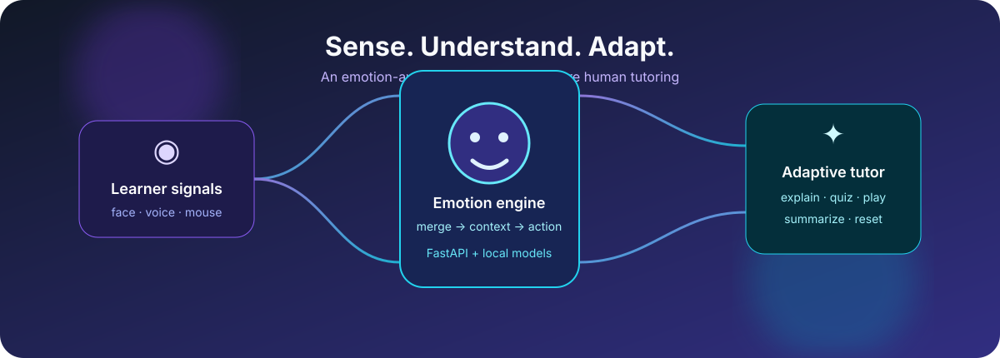
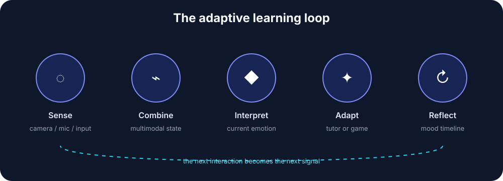

<div align="center">

# EmoLearn

### Emotion-aware learning that adapts before learners disengage

<p>
  <a href="#quick-start">Quick start</a> ·
  <a href="#how-it-works">How it works</a> ·
  <a href="#features">Features</a> ·
  <a href="#api">API</a> ·
  <a href="#contributing">Contributing</a>
</p>



<p>
  
  
  
  
</p>

</div>

## Why EmoLearn?

Most learning platforms wait for a learner to say *“I’m stuck.”* EmoLearn watches
for non-invasive signals of confusion, fatigue, boredom, or frustration and turns
them into a timely learning intervention:

> **Sense → Understand → Adapt → Learn**

It combines facial, voice, and interaction signals into a current emotional state,
then gives learners an AI tutor, a different explanation, a story, a quiz, study
resources, a video summary, or a short emotion-matched game.

> **Privacy note:** camera and microphone features are opt-in controls. Review
> your deployment, consent, retention, and local processing requirements before
> using EmoLearn with real learners.

## Features

| Experience | What it does |
| --- | --- |
| **Multimodal emotion sensing** | Combines facial, speech, and mouse/interaction signals into one current state. |
| **Adaptive AI tutor** | Explains a topic differently, switches to story mode, creates quizzes, and suggests resources. |
| **Emotion-matched games** | Offers 12 games across boredom, confusion, fatigue, and frustration. |
| **YouTube summarizer** | Produces summaries, study notes, or quizzes from YouTube links. |
| **Mood timeline** | Displays recent emotion data and sensor state so learners can reflect on patterns. |
| **Breathing reset** | Provides a short breathing exercise when a learner needs a calmer starting point. |

## How it works

<div align="center">

</div>

1. The learner enables the sensors they are comfortable using.
2. The FastAPI service reads available signals and keeps an emotion snapshot.
3. A multimodal combiner produces the current emotion and appends a local log entry.
4. The React client polls the service and adapts the tutoring experience.
5. Groq-powered tutoring turns the context into an explanation, quiz, notes, or
   a recommended activity.

## Repository layout

```text
.
├── backend/
│   ├── main.py                    # FastAPI application and REST endpoints
│   ├── modules/                   # Facial, speech, mouse, and emotion-combining logic
│   ├── models/                    # Local ML model assets
│   └── requirements.txt
├── frontend/
│   ├── src/components/             # Tutor, sensors, games, charts, and UI
│   ├── src/api/                    # Groq and YouTube integrations
│   ├── src/config/                 # Game-server and app configuration
│   └── package.json
└── docs/assets/                    # Repository-owned README visuals
```

## Quick start

### Prerequisites

- Node.js 18 or newer
- Python 3.10 or newer
- A Groq API key
- A working camera is required for facial detection; a microphone is optional

### 1. Configure secrets

```powershell
Copy-Item frontend\.env.example frontend\.env
```

Open `frontend\.env` and set `GROQ_API_KEY`. If the browser-side tutor is enabled,
also set `VITE_GROQ_API_KEY`. A `VITE_*` value is bundled into the browser, so
prefer a server-side proxy for production deployments.

### 2. Start the backend

```powershell
cd backend
python -m venv .venv
.\.venv\Scripts\Activate.ps1
pip install -r requirements.txt
python main.py
```

The API is available at `http://127.0.0.1:8000`.

### 3. Start the frontend

In a second terminal:

```powershell
cd frontend
npm install
npm run dev
```

Open `http://localhost:5173`.

### Useful development commands

```powershell
cd frontend
npm run build
npm run lint
```

## API

The primary service is `backend/main.py`.

| Method | Endpoint | Purpose |
| --- | --- | --- |
| `GET` | `/api/emotion` | Current combined emotion |
| `GET` | `/api/emotion/latest` | Latest full emotion snapshot |
| `GET` | `/api/emotion/combined` | Current merged emotion without writing a log |
| `GET` | `/api/emotion/facial` | Facial signal only |
| `GET` | `/api/emotion/voice` | Voice signal only |
| `GET` | `/api/emotion/interaction` | Interaction signal only |
| `GET` | `/api/emotion/all` | Historical emotion entries |
| `GET` | `/api/sensors/status` | Sensor and detector status |
| `POST` | `/api/sensors/camera` | Enable or disable the camera |
| `POST` | `/api/sensors/microphone` | Enable or disable the microphone |
| `GET` | `/api/sensors/cameras` | List available cameras |
| `POST` | `/api/sensors/camera/select` | Select a camera index |
| `POST` | `/api/emotion/start` | Start the detection loop |
| `POST` | `/api/emotion/stop` | Stop the detection loop |
| `POST` | `/explain` | Request an AI explanation from the backend |

## Feature guides

- [YouTube summarizer](frontend/YOUTUBE_SUMMARIZER_README.md) — summary, study
  notes, and quiz modes.
- [Games integration](frontend/GAMES_INTEGRATION_README.md) — emotion-based game
  categories, server configuration, and adding new games.
- [Frontend source](frontend/src/) · [Backend source](backend/)

## Configuration notes

- The frontend currently calls the local backend at `http://localhost:8000`.
- Configure the game host in [gameServer.ts](frontend/src/config/gameServer.ts).
- `emotion_log.json` is runtime data; do not commit learner data.
- Never commit `.env`, API keys, recordings, or camera captures.
- Replace permissive CORS settings before exposing the API beyond local development.

## Contributing

1. Create a focused branch.
2. Keep sensor behavior opt-in and document any privacy implications.
3. Add or update the relevant feature guide when behavior changes.
4. Run `npm run lint` and `npm run build` from `frontend/`.
5. Open a pull request describing the user-facing and API changes.

## Status

EmoLearn is an active prototype. Hardware-dependent emotion detection and
third-party AI/video services can vary by operating system, device, network, and
provider availability.

<div align="center">

**Build learning experiences that respond to the learner, not just the lesson.**

</div>
