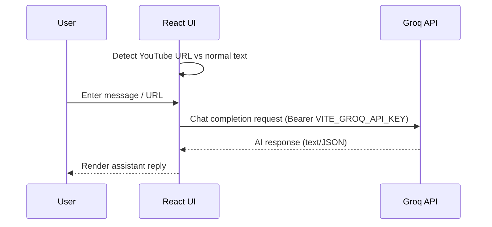

# Emolearn

Emolearn is a **reactive learning assistant**: it detects learner emotion signals (camera/voice/interaction), merges them into a single “current emotion”, and uses that context to trigger **AI tutoring interventions** (explain differently, story mode, quizzes, study resources, and YouTube summarization).

> Repo link you shared: `https://github.com/Fayazmohammed9985/Emolearn.git`

## What’s inside

- **Frontend**: Vite + React + TypeScript + shadcn/ui (`src/`)
- **Backend**: FastAPI (`backend/`)
  - Emotion detection modules (facial / speech / mouse)
  - Emotion log store (`emotion_log.json`)
  - REST endpoints for sensor toggles + emotion state
- **AI**: Groq API (key via environment variables, no hardcoding)

## System architecture (high level)

```mermaid
flowchart LR
  U[User / Learner] -->|interacts| FE[Frontend (Vite + React)]
  FE -->|HTTP JSON| BE[Backend (FastAPI)]

  subgraph Sensors
    CAM[Camera]
    MIC[Microphone]
    MOUSE[Mouse/Interaction]
  end

  BE --> CAM
  BE --> MIC
  BE --> MOUSE

  BE -->|combined emotion| FE
  FE -->|AI prompt| GROQ[Groq API]
  GROQ -->|response| FE
```

## Backend emotion pipeline

```mermaid
flowchart TD
  A[Sensor toggles from UI] --> B[/FastAPI: /api/sensors/*/]
  B --> C[Enable/disable detectors]
  C --> D[Periodic emotion loop]
  D --> E[Facial detector]
  D --> F[Speech detector]
  D --> G[Interaction detector]
  E --> H[Merge multimodal emotion]
  F --> H
  G --> H
  H --> I[(emotion_log.json)]
  H --> J[/FastAPI: /api/emotion/latest]
```

## AI Assistant flow (frontend)



## Project run (local dev)

### 1) Prerequisites

- Node.js (recommended: 18+)
- Python (recommended: 3.10+)
- A Groq API key

### 2) Configure environment variables

Create a local `.env` in repo root (or copy from `.env.example`) and set:

- `VITE_GROQ_API_KEY` (frontend usage)
- `GROQ_API_KEY` (backend usage)

> Note: `.env` is intentionally ignored by git. Do not commit secrets.

### 3) Run frontend (Vite)

```bash
npm install
npm run dev
```

Frontend default: `http://localhost:5173`

### 4) Run backend (FastAPI)

From `backend/`:

```bash
python -m venv .venv
.\.venv\Scripts\activate
pip install -r requirements.txt
python main.py
```

Backend default: `http://127.0.0.1:8000`

## Key backend endpoints

- `GET /api/emotion` – current combined emotion
- `GET /api/emotion/latest` – latest full emotion payload (from `emotion_log.json` if present)
- `POST /api/sensors/camera` – toggle camera on/off
- `POST /api/sensors/microphone` – toggle microphone on/off
- `GET /api/sensors/status` – current sensor + detection status

## YouTube summarizer

See `YOUTUBE_SUMMARIZER_README.md` for feature details and usage.

## Security notes

- **No API keys should be hardcoded** in `src/` or `backend/`. Keys must come from `.env` / environment variables.
- If a key was ever committed previously, **revoke/rotate it** because Git history may contain it.